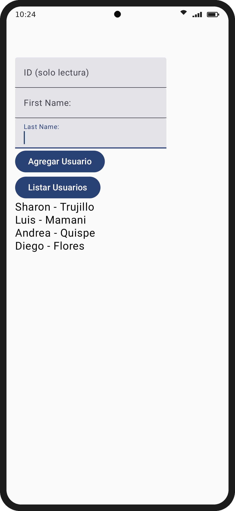
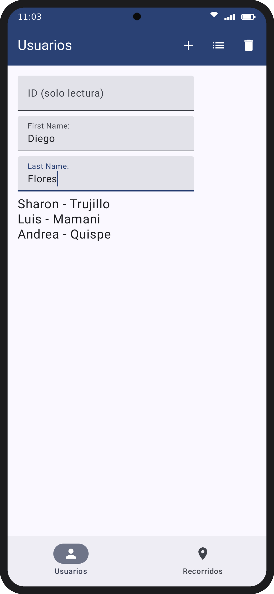
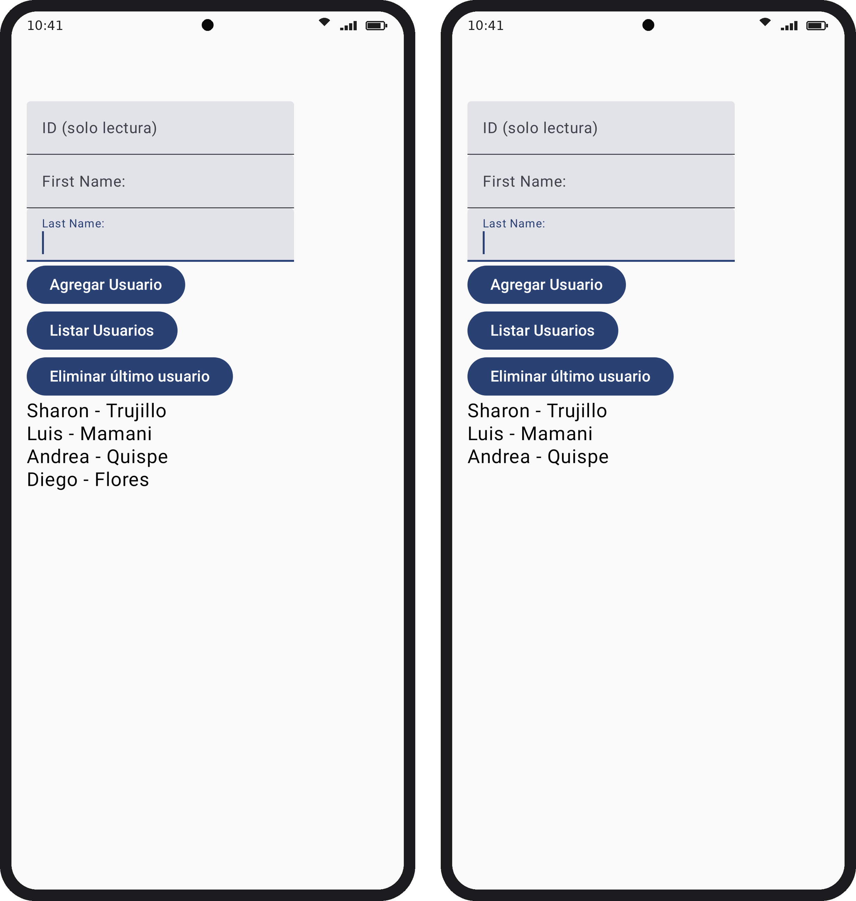
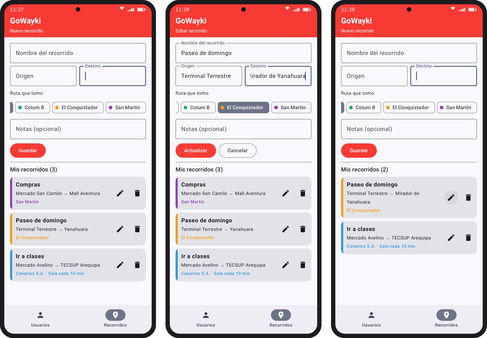

# Laboratorio 07 - Uso de Base de datos SQLite con Room

Programación en Móviles · Sharon Jennifer Trujillo Sulca · Grupo D

Proyecto **DatosSinMVVM** hecho con Kotlin, Jetpack Compose y Room.

## Contenido

| Parte | Qué hace | Archivos |
|---|---|---|
| Parte guiada | Agregar y listar usuarios en SQLite con Room | `User.kt`, `UserDao.kt`, `UserDatabase.kt`, `ScreenUser.kt` |
| Ejercicio 1 | Eliminar el último usuario y mover las acciones a un TopAppBar dentro de un Scaffold | `UserDao.kt`, `ScreenUser.kt` |
| Ejercicio 2 | CRUD de la vista "Nueva tarea" del proyecto final | `tareas/Tarea.kt`, `tareas/TareaDao.kt`, `tareas/AppDatabase.kt`, `tareas/ScreenTareas.kt` |

Cada parte tiene un tag: `parte-guiada`, `ejercicio1-eliminar`, `ejercicio1-scaffold`, `ejercicio2-crud`.

## Capturas

| Parte guiada | Ejercicio 1 (Scaffold) |
|---|---|
|  |  |

## Notas

- Con AGP 9 el plugin `kotlin-kapt` ya no se aplica igual, se usa `com.android.legacy-kapt`.
- Room 2.8.4 y `material-icons-core` para los íconos del TopAppBar.
